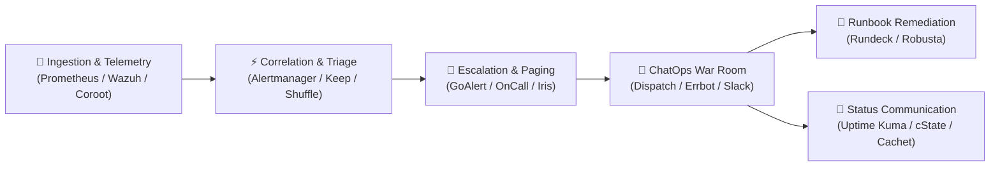

  

# 🚨 Awesome Incident Response & Incident Management

  
  
  
  
  

  <strong>A curated collection of leading SaaS platforms and production-ready open-source projects for Incident Response, Incident Management, On-Call Scheduling, Alert Routing, Escalation Workflows, ChatOps, Postmortems & Status Pages.</strong>

  Last updated: November 2026 • Maintained for Site Reliability Engineers (SREs), DevOps Engineers, SOC Analysts, and Platform Resilience Teams.

---

## 📑 Table of Contents

- [📊 Sector Overview & Market Dynamics](#-sector-overview--market-dynamics)
- [☁️ SaaS & Hosted Incident Management Platforms](#️-saas--hosted-incident-management-platforms)
- [🔓 Open-Source Incident Response & Management Projects](#-open-source-incident-response--management-projects)
  - [🚨 Core On-Call, Incident Management & AIOps Engines](#-core-on-call-incident-management--aiops-engines)
  - [🛡️ Security Incident Response (SIRP), SOAR & Forensics](#️-security-incident-response-sirp-soar--forensics)
  - [📡 Status Pages & Service Health Communication](#-status-pages--service-health-communication)
  - [💬 ChatOps, Automation & Runbook Engines](#-chatops-automation--runbook-engines)
- [🧩 Architecture & Framework Suggestions](#-architecture--framework-suggestions)
- [🤝 How to Contribute](#-how-to-contribute)
- [💖 Support & Sponsorship](#-support--sponsorship)
- [📈 Star History](#-star-history)
- [⚖️ Disclaimer](#️-disclaimer)

---

## 📊 Sector Overview & Market Dynamics

The global Incident Response (IR) and Incident Management (IM) market represents an estimated **$35 billion to $42 billion** ecosystem expanding at a rapid Compound Annual Growth Rate (CAGR) exceeding 18% through 2030. The industry exhibits a **moderately to highly fragmented structure** characterized by two coexisting forces: large platform consolidators (e.g., ServiceNow, Cisco/Splunk, Atlassian) absorbing broad enterprise IT workflows, alongside an agile, rapidly innovating cohort of specialized cloud-native startups and open-source frameworks addressing microservice complexity, Kubernetes diagnostics, AI-assisted root-cause analysis (RCA), and automated ChatOps.

---

## ☁️ SaaS & Hosted Incident Management Platforms

The following table benchmarks category-leading SaaS solutions for on-call scheduling, alert deduplication, incident war rooms, and status communications. Products are sorted in descending order by **Company Valuation / Market Capitalization / Annual Revenue**.

| SaaS Product | Valuation / Scale | Starting Pricing | Free Tier Limits / Free Trial Details | Core Focus & Strengths |
| :--- | :--- | :--- | :--- | :--- |
| [ServiceNow Incident Management](https://servicenow.com) | ~$104 Billion (Market Cap) | ~$70.00 / fulfiller / month (billed annually) | No permanent free tier. Full functional evaluation available via free Personal Developer Instances (PDIs) on the ServiceNow Developer Portal. | Enterprise IT service management (ITSM), major incident management, automated triage, and change control. |
| [Opsgenie (Atlassian)](https://atlassian.com) | ~$37.7 Billion (Market Cap) | $9.45 / user / month (billed annually) | **Free Forever Tier**: Up to 5 users, basic alerting, unlimited email/push, 100 account-wide SMS/month, 1 escalation policy per team (voice alerts excluded). 14-day free trial on paid plans. | Deep integration with Jira Service Management, Confluence postmortem templates, and Bitbucket pipelines. |
| [Splunk On-Call (formerly VictorOps)](https://splunk.com) | $28.0 Billion (Acquisition by Cisco) | $5.00 / user / month (for teams up to 10 users, billed annually) | No permanent free tier. Offers a 14-day free trial with full access to alert routing, timeline collaboration, and live shift escalations. | Real-time chat collaboration, DevOps alert routing, and observability context correlation. |
| [Zoho Site24x7 / StatusIQ](https://zoho.com) | ~$12.5 Billion / $1.5B Revenue (Bootstrapped Valuation) | $9.00 / month (Monitoring) / $9.00 / month (StatusIQ) | **Free Forever Tier**: Monitor up to 50 basic website/port endpoints with email alerts; StatusIQ includes 1 free status page with up to 10 components and 5 team members. 30-day unrestricted free trial. | Unified IT infrastructure monitoring, automated downtime alerting, and stakeholder status pages. |
| [xMatters (Everbridge)](https://xmatters.com) | $1.8 Billion (Acquisition by Thoma Bravo) | $9.00 / user / month (Starter plan, billed annually) | **Free Forever Tier**: Up to 5 users, global on-call scheduling, mobile push and email notifications, Flow Designer workflows, 90-day data retention (SMS and voice calls excluded). | Enterprise business continuity, automated multi-channel messaging, and low-code incident workflow integration. |
| [PagerDuty](https://pagerduty.com) | ~$1.25 Billion (Market Cap) | $21.00 / user / month (Professional plan, billed annually) | **Free Forever Tier**: Up to 5 users, 1 on-call schedule, 1 escalation policy, and 100 account-wide SMS/phone notifications per month. 14-day free trial for Professional/Enterprise tiers. | Digital operations management, real-time alerting, on-call rotations, automated event orchestration, and AIOps noise reduction. |
| [BigPanda](https://bigpanda.io) | $1.2 Billion (Valuation) | ~$500.00 / month (~$6,000 / year base credit plan; custom annual enterprise contracts) | No self-service free tier. Custom proof-of-concept (PoC) sandboxes available upon sales-guided evaluation request. | Enterprise event correlation, alert noise reduction, automated root-cause analysis, and cross-monitoring aggregation. |
| [Incident.io](https://incident.io) | $400 Million (Valuation) | $15.00 / user / month (Core Incident Management, billed annually) | **Free Forever Tier (Basic)**: Up to 5 users, Slack/Teams-native incident response, 1 on-call schedule, 1 public status page, and core automated workflows. 14-day free trial on higher tiers. | Slack-first incident coordination, automated war-room timelines, on-call escalation, and postmortem generation. |
| [FireHydrant](https://firehydrant.com) | $88.7 Million (Acquisition by Freshworks) | $25.00 / responder / month (Pro plan, billed annually) | **Free Forever Tier**: Up to 10 responders, 2 automated runbooks, 1 public status page, Slack/Teams chatbot, and 3 integrations (on-call scheduling requires Pro). 14-day free trial of Pro plan. | Automated runbook execution, service catalogs, incident retrospectives, and reliability tracking. |
| [Rootly](https://rootly.com) | ~$55 Million (Valuation) | $20.00 / user / month (Incident Response module, billed annually) | No permanent free tier (Startup Program offers "Pay What You Can" or $1/user/mo for teams <25 employees). 14-day full-access free trial. | Slack-native and Microsoft Teams-native incident workflow automation, Zoom war rooms, Jira syncing, and AI retrospectives. |

---

## 🔓 Open-Source Incident Response & Management Projects

A comprehensive index of self-hosted, open-source repositories powering modern SRE, DevOps, and security operations workflows. Each repository displays its live Stars_Count badge linking directly to its stargazers page and is sorted by **GitHub Stars_Count (descending)**.

| Open-Source Project | GitHub_Stars | Primary Role & Capabilities | Official Repository |
| :--- | :--- | :--- | :--- |
| **[Uptime Kuma](https://github.com/louislam/uptime-kuma)** |  | Self-hosted monitoring tool featuring interactive status pages, ping/HTTP/TCP/DNS checks, and notifications to 90+ multi-channel providers (Telegram, Slack, Discord, Pushover). | [louislam/uptime-kuma](https://github.com/louislam/uptime-kuma) |
| **[Wazuh](https://github.com/wazuh/wazuh)** |  | Open-source enterprise security platform combining unified XDR and SIEM protection, active automated response, file integrity monitoring, and vulnerability detection. | [wazuh/wazuh](https://github.com/wazuh/wazuh) |
| **[Cachet](https://github.com/cachethq/cachet)** |  | Battle-tested open-source status page system designed to communicate service downtime, component health, and scheduled maintenance clearly to end users. | [cachethq/cachet](https://github.com/cachethq/cachet) |
| **[Gatus](https://github.com/TwiN/gatus)** |  | Automated developer-oriented service health dashboard and status page configured entirely via YAML, featuring instant incident notifications and badge endpoints. | [TwiN/gatus](https://github.com/TwiN/gatus) |
| **[Keep](https://github.com/keephq/keep)** |  | Open-source AIOps and alert orchestration platform designed to deduplicate, enrich, correlate, and automate incident workflows across heterogeneous monitoring tools. | [keephq/keep](https://github.com/keephq/keep) |
| **[Prometheus Alertmanager](https://github.com/prometheus/alertmanager)** |  | Foundational alerting gateway for the Prometheus ecosystem that handles alert deduplication, grouping, routing, inhibition, and silencing before notifying downstream teams. | [prometheus/alertmanager](https://github.com/prometheus/alertmanager) |
| **[Coroot](https://github.com/coroot/coroot)** |  | Open-source observability and APM tool powered by eBPF with automated root-cause analysis (RCA), SLO tracking, distributed tracing, and smart alerts. | [coroot/coroot](https://github.com/coroot/coroot) |
| **[OneUptime](https://github.com/OneUptime/oneuptime)** |  | Complete open-source SRE and observability suite unifying incident management, on-call duty scheduling, status pages, uptime monitoring, and telemetry logs. | [OneUptime/oneuptime](https://github.com/OneUptime/oneuptime) |
| **[MISP](https://github.com/MISP/MISP)** |  | Open-source threat intelligence and sharing platform used globally by SOCs and CERTs for collecting, sharing, storing, and correlating indicators of compromise (IOCs). | [MISP/MISP](https://github.com/MISP/MISP) |
| **[Dispatch](https://github.com/Netflix/dispatch)** |  | Netflix-developed crisis and incident management orchestration engine integrating Slack, Jira, Zoom, and Google Workspace to automate war rooms and task delegation. | [Netflix/dispatch](https://github.com/Netflix/dispatch) |
| **[Rundeck](https://github.com/rundeck/rundeck)** |  | Open-source operational orchestration and runbook automation console giving responders self-service remediation workflows to repair production services safely. | [rundeck/rundeck](https://github.com/rundeck/rundeck) |
| **[Cabot](https://github.com/arachnys/cabot)** |  | Self-hosted, lightweight infrastructure monitoring and alert service built to provide PagerDuty-like functionality (SMS, phone, email, Slack) with zero external dependencies. | [arachnys/cabot](https://github.com/arachnys/cabot) |
| **[Velociraptor](https://github.com/Velocidex/velociraptor)** |  | Advanced digital forensics and incident response (DFIR) endpoint hunting platform using VQL (Velociraptor Query Language) for surgical live forensic collection. | [Velocidex/velociraptor](https://github.com/Velocidex/velociraptor) |
| **[TheHive](https://github.com/TheHive-Project/TheHive)** |  | Scalable Security Incident Response Platform (SIRP) built for SOC, CSIRT, and CERT teams to collaboratively investigate cyber incidents, evidence, and remediation tasks. | [TheHive-Project/TheHive](https://github.com/TheHive-Project/TheHive) |
| **[HolmesGPT](https://github.com/HolmesGPT/holmesgpt)** |  | CNCF Sandbox AI-powered SRE and incident response agent that autonomously investigates Kubernetes alerts, queries Prometheus logs, and drafts root-cause diagnoses. | [HolmesGPT/holmesgpt](https://github.com/HolmesGPT/holmesgpt) |
| **[Grafana OnCall](https://github.com/grafana-cold-storage/oncall)** |  | Developer-friendly on-call management and alert escalation tool natively integrated with Grafana, Prometheus, Telegram, and Slack. | [grafana-cold-storage/oncall](https://github.com/grafana-cold-storage/oncall) |
| **[Errbot](https://github.com/errbotio/errbot)** |  | Extensible Python ChatOps bot daemon connecting to Slack, Discord, Mattermost, and Telegram to trigger triage, incident commands, and status updates directly in chat. | [errbotio/errbot](https://github.com/errbotio/errbot) |
| **[Robusta](https://github.com/robusta-dev/robusta)** |  | Kubernetes incident response and troubleshooting automation platform that enriches Prometheus alerts with pod logs, graphs, AI summaries, and remediation playbooks. | [robusta-dev/robusta](https://github.com/robusta-dev/robusta) |
| **[cState](https://github.com/cstate/cstate)** |  | Ultra-fast, serverless, static status page powered by Hugo and GitHub Pages, delivering high resilience even when your primary infrastructure is completely offline. | [cstate/cstate](https://github.com/cstate/cstate) |
| **[GoAlert](https://github.com/target/goalert)** |  | Enterprise open-source on-call scheduling, notification routing, and automated escalation platform developed and proven in high-volume production by Target. | [target/goalert](https://github.com/target/goalert) |
| **[Alerta](https://github.com/alerta/alerta)** |  | Scalable alert management and correlation system designed to consolidate alerts from Prometheus, Nagios, Zabbix, and AWS CloudWatch into a unified console. | [alerta/alerta](https://github.com/alerta/alerta) |
| **[Shuffle](https://github.com/Shuffle/Shuffle)** |  | Open-source Security Orchestration, Automation, and Response (SOAR) platform featuring an interactive visual workflow builder and hundreds of app connectors. | [Shuffle/Shuffle](https://github.com/Shuffle/Shuffle) |
| **[Statping-ng](https://github.com/statping-ng/statping-ng)** |  | Drop-in open-source status page and monitoring dashboard for web apps and microservices featuring automated downtime announcements and analytics. | [statping-ng/statping-ng](https://github.com/statping-ng/statping-ng) |
| **[DFIR-IRIS](https://github.com/dfir-iris/iris-web)** |  | Collaborative digital forensics and incident response platform enabling security teams to organize forensic investigations, evidence, and IOC tracking. | [dfir-iris/iris-web](https://github.com/dfir-iris/iris-web) |
| **[Oncall (by LinkedIn)](https://github.com/linkedin/oncall)** |  | Open-source calendar tool and shift-scheduling web application developed by LinkedIn for managing large engineering on-call rotations and handoffs. | [linkedin/oncall](https://github.com/linkedin/oncall) |
| **[Opsdroid](https://github.com/opsdroid/opsdroid)** |  | Lightweight open-source ChatOps bot framework written in Python for orchestrating incident actions and parsing NLP commands in Slack, Matrix, and Teams. | [opsdroid/opsdroid](https://github.com/opsdroid/opsdroid) |
| **[Iris (by LinkedIn)](https://github.com/linkedin/iris)** |  | Highly configurable and scalable paging and messaging service designed by LinkedIn to route critical alerts across multiple notification channels. | [linkedin/iris](https://github.com/linkedin/iris) |
| **[IncidentBot](https://github.com/incidentbot/incidentbot)** |  | Open-source Slack-based incident management bot that automates war-room creation, role assignments (Incident Commander, Scribe), and postmortem document generation. | [incidentbot/incidentbot](https://github.com/incidentbot/incidentbot) |

---

### 🚨 Core On-Call, Incident Management & AIOps Engines
- **[Prometheus Alertmanager](https://github.com/prometheus/alertmanager)**: The de facto standard for Kubernetes and Prometheus monitoring stacks. Handles alert deduplication, grouping, silencing, and notification fan-out.
- **[Keep](https://github.com/keephq/keep)**: Next-gen open-source AIOps platform that sits between your monitors and incident responders to automate correlation and alert workflows.
- **[GoAlert](https://github.com/target/goalert)**: High-resilience, production-grade scheduling and multi-channel notification engine battle-tested across massive enterprise infrastructure.
- **[Grafana OnCall](https://github.com/grafana-cold-storage/oncall)**: Intuitive scheduling, escalation trees, and direct Slack integration built for modern observability setups.
- **[Netflix Dispatch](https://github.com/Netflix/dispatch)**: Orchestrates the entire incident lifecycle across Slack, Zoom, Google Docs, and Jira.

### 🛡️ Security Incident Response (SIRP), SOAR & Forensics
- **[Wazuh](https://github.com/wazuh/wazuh)**: Unified SIEM/XDR platform providing endpoint intrusion detection, file integrity monitoring, and automated incident containment.
- **[TheHive](https://github.com/TheHive-Project/TheHive)** & **[DFIR-IRIS](https://github.com/dfir-iris/iris-web)**: Collaborative investigation boards for security operations centers (SOCs) to manage cases, evidence, and observables.
- **[Velociraptor](https://github.com/Velocidex/velociraptor)**: Real-time digital forensics hunting tool allowing analysts to query thousands of endpoints with VQL in seconds.
- **[Shuffle](https://github.com/Shuffle/Shuffle)**: Open-source SOAR platform for wiring together automated threat triage, containment, and notification playbooks.

### 📡 Status Pages & Service Health Communication
- **[Uptime Kuma](https://github.com/louislam/uptime-kuma)**: Beautiful, modern, self-hosted uptime monitor and public status page supporting 90+ alert channels.
- **[Gatus](https://github.com/TwiN/gatus)**: Ultra-lean, YAML-configured status dashboard checking HTTP, ICMP, TCP, and DNS endpoints with incident timelines.
- **[Cachet](https://github.com/cachethq/cachet)**: Traditional JSON-API-powered status page system for logging outages, scheduled maintenance, and service metrics.
- **[cState](https://github.com/cstate/cstate)**: Fully static, JAMstack-based status page hosted on GitHub Pages or Cloudflare Workers—ensuring uptime communication even if your core servers are down.

### 💬 ChatOps, Automation & Runbook Engines
- **[Rundeck](https://github.com/rundeck/rundeck)**: Self-service job scheduling and automated operational runbooks to speed up mean time to recovery (MTTR).
- **[HolmesGPT](https://github.com/HolmesGPT/holmesgpt)** & **[Robusta](https://github.com/robusta-dev/robusta)**: AI-powered Kubernetes diagnostics that analyze pods, nodes, and crash loops to produce instant postmortem insights.
- **[Errbot](https://github.com/errbotio/errbot)** & **[Opsdroid](https://github.com/opsdroid/opsdroid)**: Python ChatOps frameworks that allow engineers to execute containment, rollbacks, and diagnostics directly inside incident channels.

---

## 🧩 Architecture & Framework Suggestions

When constructing a zero-trust, resilient self-hosted incident response stack:

> [!IMPORTANT]
> **Out-of-Band Resilience Rule**: Ensure your alerting gateways (SMS/voice, notification engines) and public status pages (such as cState or Uptime Kuma) are hosted on independent, out-of-band cloud infrastructure (e.g., Cloudflare Workers, AWS Lambda, separate VPS) to prevent total communication blackout during primary datacenter disruptions.

---

## 🤝 How to Contribute

We welcome community contributions! To suggest a new open-source project or SaaS platform:

1. 🍴 **Fork the repository**.
2. 🌿 **Create a new branch**: `git checkout -b feature/add-new-tool`
3. 📝 **Add your entry**: Ensure you follow the table formatting, provide accurate starting pricing, precise free-tier limits, company valuation or Stars_Count badges, and factual descriptions.
4. 🚀 **Submit a Pull Request** with a brief summary of the project's key features.

---

## 💖 Support & Sponsorship

If this curated ecosystem helps keep your systems reliable and your on-call shifts peaceful, consider supporting the maintenance of this repository!

  

* ⭐ **Star the repository** to boost visibility for the SRE and DevOps community.
* 🍴 **Fork and share** with your platform engineering and security teams.
* ☕ **Buy me a coffee**: Sponsor directly through the [GitHub Sponsor Dashboard](https://github.com/sponsors/ishandutta2007).

---

## 📈 Star History

---

## ⚖️ Disclaimer

- This repository is a community-curated directory intended for educational, architectural, and evaluation purposes.
- All brand names, product trademarks, and logos belong to their respective corporate owners.
- Commercial pricing, free tier terms, and trial policies change periodically; please verify current plan details directly on the vendors' official websites.
